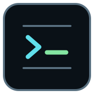
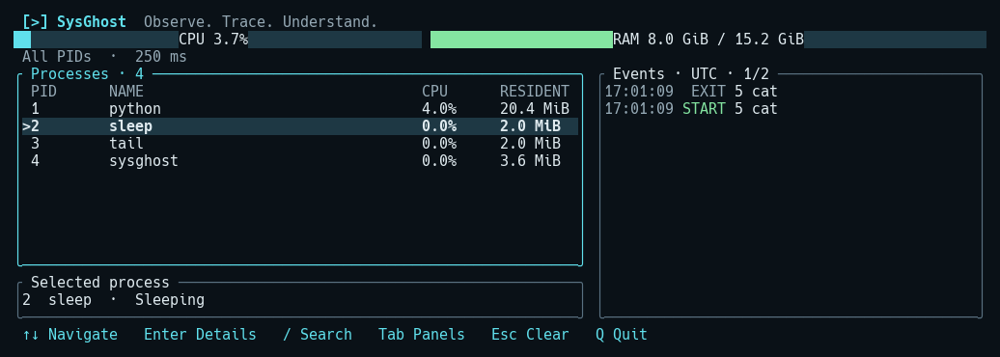

<p align="center"></p>
<h1 align="center">SysGhost</h1>
<p align="center"><strong>Observe. Trace. Understand.</strong></p>
<p align="center">
  <a href="https://www.rust-lang.org/"></a>
  <a href="https://www.kernel.org/"></a>
  <a href="LICENSE"></a>
  <a href="https://github.com/0xnullroot/SysGhost/actions/workflows/ci.yml"></a>
</p>

SysGhost is a lightweight Linux runtime monitor written in Rust. It shows which processes are active, how much CPU and resident memory they use, and which processes appear or disappear between samples.

## Features

- Live system CPU and memory usage alongside a process table sorted by CPU.
- Case-insensitive process-name search, PID search, and an exact PID filter.
- Process details including parent PID, state, CPU, resident memory, and kernel start ticks.
- Scrollable UTC event log for process starts and exits, with up to 512 events per session.
- Configurable dashboard refresh and JSON snapshots for scripts.
- Basic monitoring as a regular user. SysGhost runs locally and leaves process command-line arguments unread.

## Installation

Use Linux with an up-to-date stable Rust toolchain and a C linker. On Fedora, install `cargo` and `gcc` through DNF if needed.

```bash
git clone https://github.com/0xnullroot/SysGhost.git
cd SysGhost
cargo install --locked --path .
sysghost
```

## Usage

```bash
sysghost
sysghost --help
sysghost --version
sysghost --interval 1000
sysghost --pid 1234
sysghost --json > snapshot.json
sysghost --pid 1234 --json
```

`--interval` sets the dashboard refresh in milliseconds. The default is 1,000, with a supported range of 200 to 60,000. `--json` samples twice over a short interval to measure CPU, writes one snapshot to stdout, and exits. JSON includes the sampling time in Unix milliseconds and memory in bytes. CPU usage may be `null` for a process with only one observation. A process can exceed 100% CPU when it uses several logical cores.

## Terminal preview


Captured from the running dashboard on Fedora in an isolated PID namespace.

The dashboard shows both panels side by side in terminals at least 96 columns wide. In a narrower terminal, use Tab to switch panels.

| Key | Action |
| --- | --- |
| ↑ / ↓ | Move the process selection or scroll through older events |
| Enter | Open the selected process or apply the search |
| `/` | Filter by process name or PID |
| Tab | Switch between Processes and Events |
| Esc | Close details, cancel a search edit, or clear the current filter |
| Q / Ctrl+C | Quit and restore the terminal. Use Ctrl+C while editing search. |

## Architecture

| Module | Role |
| --- | --- |
| `main`, `cli` | Parse options, export JSON, and manage terminal and shutdown handling |
| `monitor`, `models` | Sample system CPU and memory through Sysinfo and read Linux process stats from `/proc/<pid>/stat` |
| `events` | Compare snapshots using PID and kernel start ticks |
| `app`, `ui` | Manage selection, search, event history, and rendering with Crossterm and Ratatui |

## Current limitations

**Polling may miss short-lived processes.** The event log reflects visibility at sample boundaries. Timestamps record when SysGhost observes a change. Permission rules, PID namespaces, and procfs mount options can affect visibility. An unreadable process is skipped. A zombie can remain visible until it is reaped. Resident memory is the kernel's sampled RSS estimate.

Events are kept in memory for the current session. v0.1.0 limits collection to process and system statistics exposed by the kernel.

## Roadmap

Later versions may explore syscall tracing, filesystem activity, network visibility, and eBPF integration.

## Contributing

See [Contributing](CONTRIBUTING.md) for local checks and pull request guidance, [Security](SECURITY.md) for private reporting, and the [changelog](CHANGELOG.md) for release changes.

SysGhost is maintained by **0xnullroot** and available under the [MIT license](LICENSE).
